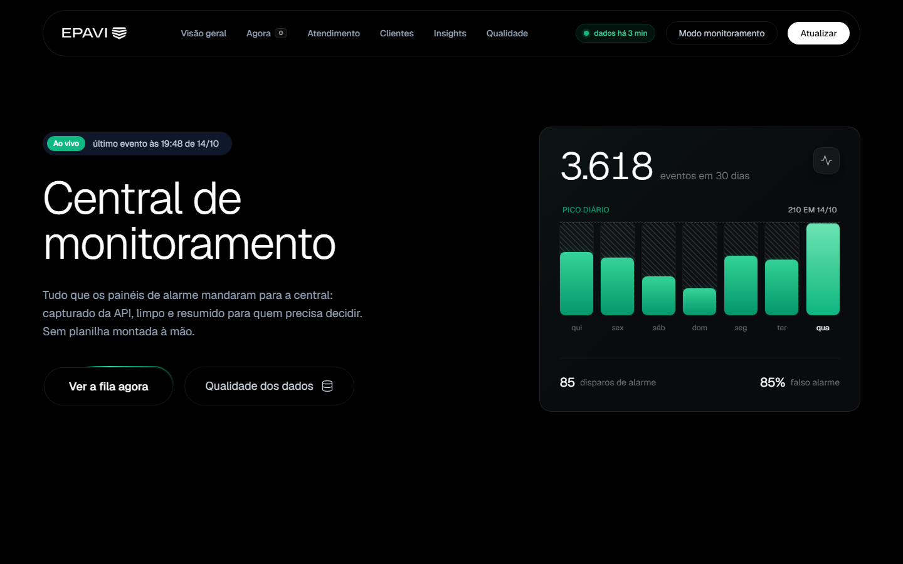
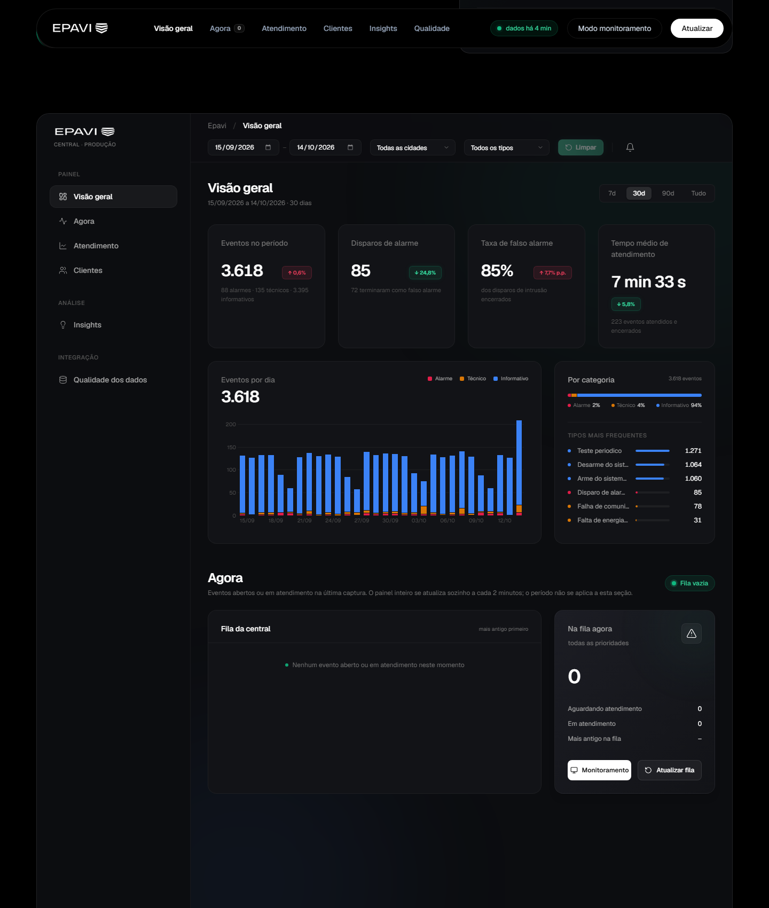
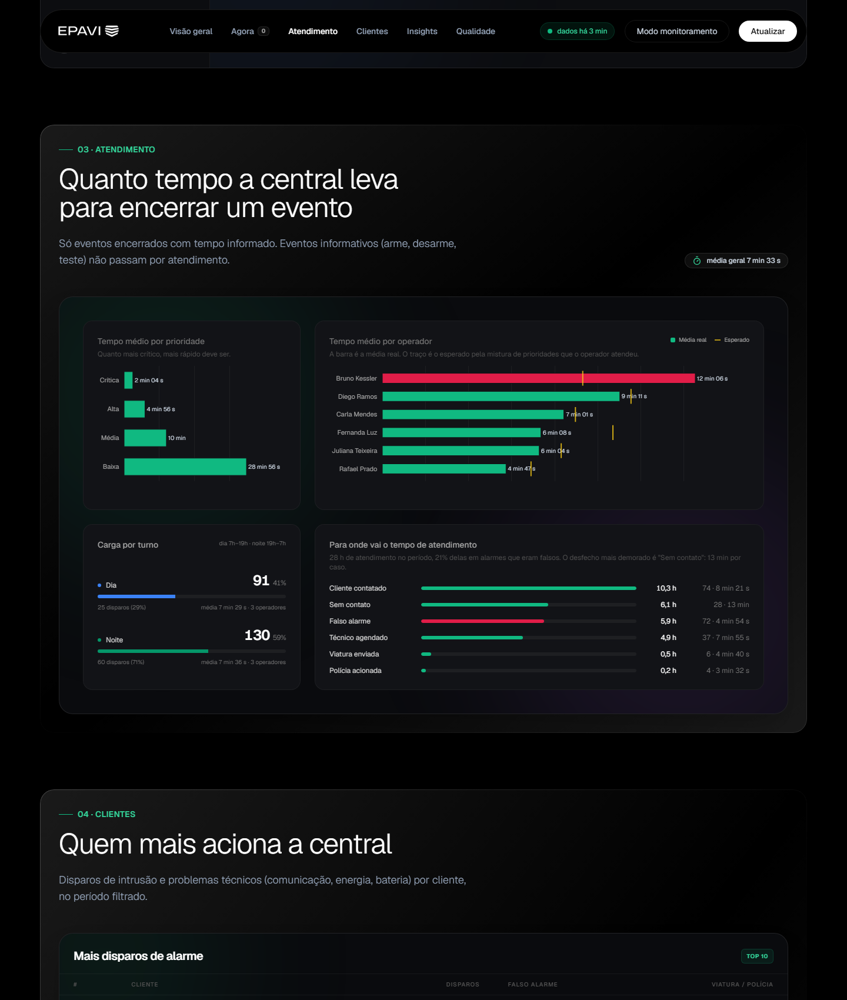
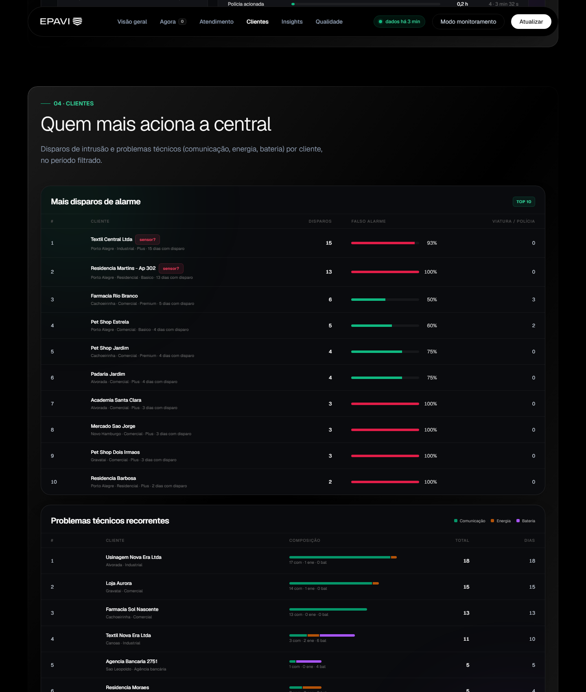
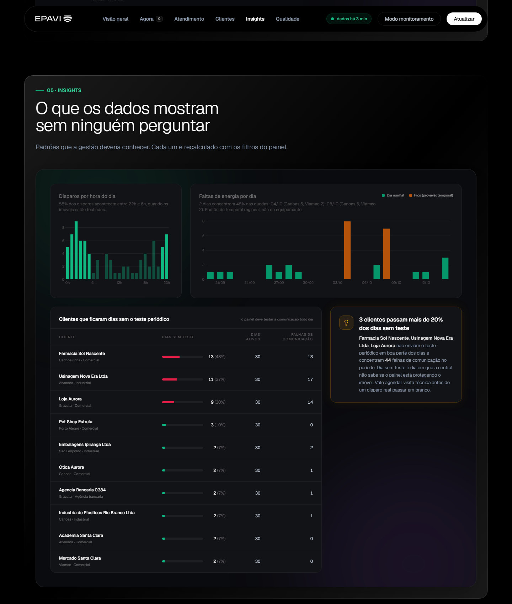
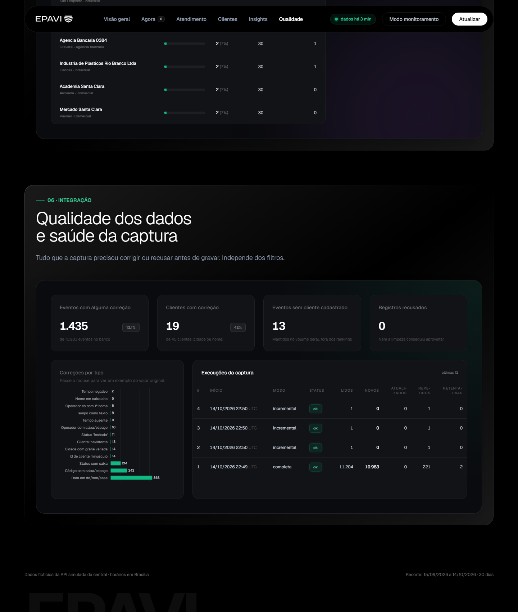
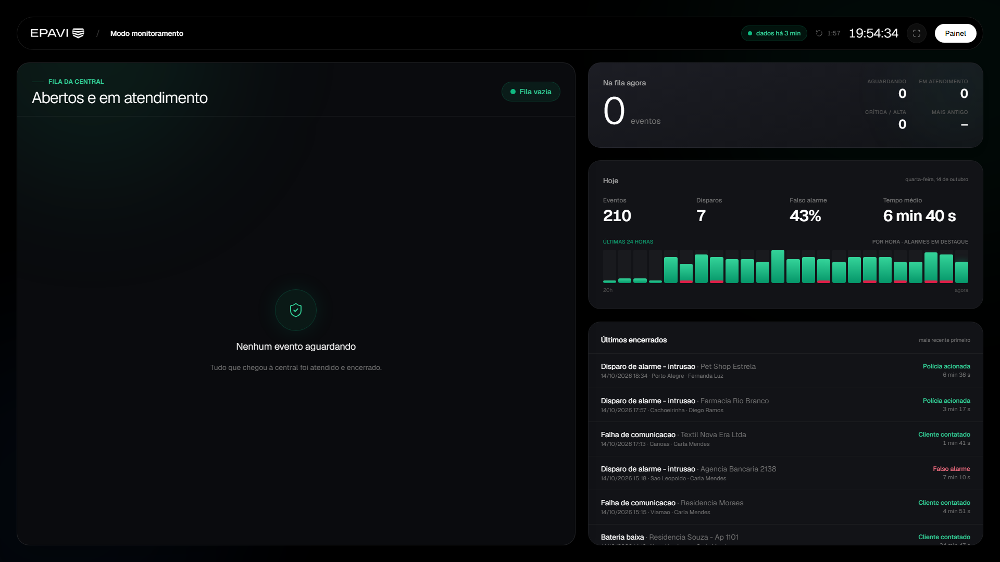

# Central de Monitoramento · captura e painel

Primeira versão funcional do fluxo **API da central → captura → banco → painel**, feita para o
teste técnico da Epavi.

- **Captura** incremental e resiliente em Python, gravando em SQLite sem duplicar nem distorcer.
- **Painel** web (Flask + HTML) com os cinco indicadores pedidos, três filtros e cinco insights
  calculados dos dados.
- **Modo monitoramento**, um "modo TV" para deixar aberto numa tela da central. Ele mostra, em
  letras grandes e sem precisar mexer em nada, os alarmes que estão abertos ou em atendimento
  naquele momento: o mais urgente aparece primeiro, e o tempo de espera fica vermelho quando passa
  do aceitável para a prioridade. Ao lado ficam os números do dia e os últimos atendimentos
  encerrados. A tela se atualiza sozinha a cada 2 minutos, e esse tempo pode ser menor: com
  `python iniciar.py --intervalo 60`, por exemplo, a captura, o painel e a TV passam a se
  atualizar a cada minuto (o mínimo é 30 segundos, para respeitar o limite da API).
- Tudo roda **sem internet** depois do `pip install`.





---

## 1. Como rodar

Testado em Windows com Python 3.10. Precisa de Python 3.9 ou mais novo; não usa nada específico de sistema operacional.

```bash
# 1. clone e entre na pasta
git clone <url-do-repositorio>
cd teste

# 2. ambiente virtual
python -m venv .venv
.venv\Scripts\activate          # Windows
# source .venv/bin/activate     # Linux / macOS

# 3. dependências
pip install -r requirements.txt

# 4. configuração: a chave da API fica num .env, fora do git
copy .env.example .env          # Windows
# cp .env.example .env          # Linux / macOS
# depois abra o .env e preencha CENTRAL_API_KEY (a da API mock está em api_mock/README_API.md)
```

Abra **dois terminais** (com o ambiente ativado em cada um):

```bash
# Terminal 1: a API simulada da central (vem no kit; é um sistema externo, por isso roda à parte)
python api_mock/mock_api.py --silencioso

# Terminal 2: captura a cada 2 minutos + painel, num comando só
python iniciar.py
```

Abra **http://127.0.0.1:8050** (painel) ou **http://127.0.0.1:8050/monitoramento** (modo TV).
Na primeira vez, o `iniciar.py` baixa o histórico completo (~16 s) antes de abrir o painel. Depois,
a captura roda sozinha a cada 2 minutos buscando só o que mudou, e o painel e o modo
monitoramento se atualizam no mesmo ritmo. `Ctrl+C` encerra os dois.

Opções do `iniciar.py`:

```bash
python iniciar.py --intervalo 60     # tudo a cada 1 min em vez de 2 (mínimo: 30 s)
python iniciar.py --intervalo 300    # tudo a cada 5 min
python iniciar.py --porta 9000       # painel em outra porta
python iniciar.py --recriar          # apaga o banco e captura tudo de novo antes de subir
```

Captura e painel também rodam separados, para usar com o agendador do sistema ou avulso:

```bash
python capturar.py                   # uma rodada (completa na 1ª vez, incremental depois)
python capturar.py --a-cada 120      # fica rodando, uma rodada a cada 2 min
python capturar.py --verboso         # progresso página a página
python capturar.py --recriar         # apaga o banco e captura tudo de novo
python painel.py                     # só o painel, em http://127.0.0.1:8050
python -m pytest -q                  # 43 testes da limpeza e da gravação
```

O banco fica em `dados/central.db` e os logs em `logs/captura_AAAA-MM-DD.log`; os dois estão
fora do repositório (`.gitignore`). Caminhos, URL e chave da API podem ser trocados por
variáveis de ambiente `CENTRAL_*`, no `.env` ou no próprio ambiente (ver [`.env.example`](.env.example) e [`central/config.py`](central/config.py)). A chave da API é a única sem valor padrão: não fica escrita no código.

> **Se a API mock for reiniciada em outro dia**, ela gera outro histórico e renumera os
> eventos. A captura detecta isso e para com uma mensagem pedindo `--recriar`
> (`python iniciar.py --recriar`), em vez de misturar dois conjuntos de ids. Isso é explicado em [Decisões](#5-decisões-e-trade-offs).

---

## 2. Arquitetura

```
┌─────────────────┐   HTTP (X-API-Key)   ┌────────────────────────────┐        ┌──────────────┐
│  API da central │ ───────────────────▶ │  capturar.py               │ ─────▶ │  SQLite      │
│  (api_mock)     │  429 / 503 / lenta   │  central/api.py  busca     │ upsert │  dados/      │
│                 │ ◀─ retentativa ───── │  central/normalizacao.py   │        │  central.db  │
└─────────────────┘                      │  central/banco.py grava    │        └──────┬───────┘
                                         │  central/captura.py orq.   │               │ leitura (WAL)
                                         └────────────────────────────┘               ▼
                                                                              ┌──────────────────┐
                                                           navegador ◀──────  │  painel.py       │
                                                           HTML + JSON        │  painel/app.py   │
                                                                              │  painel/consultas│
                                                                              └──────────────────┘
```

**Captura** ([`central/`](central/)), uma rodada por execução:

1. `GET /saude`: confere se a API ainda serve a mesma janela de histórico gravada no banco.
2. Lê a **marca d'água** (maior `atualizado_em` já gravado). Sem marca: rodada completa.
   Com marca: pede só `atualizado_desde=<marca>`.
3. Atualiza os catálogos (tipos de evento, clientes).
4. Percorre os eventos **por cursor** (ver Decisões), uma página de 200 por vez. Cada página é
   limpa, gravada e confirmada (`commit`) junto com a marca d'água antes de pedir a próxima.
5. Completa nomes de operador que vieram só com o primeiro nome e fecha a rodada em
   `execucoes` com as contagens.

Falhas temporárias (`429`, `5xx`, timeout, queda de conexão) são repetidas até 8 vezes com
espera crescente (0,5 s → 30 s) e respeito ao `Retry-After`. Falhas definitivas (`401`,
`400`) param na hora. Se a API cair no meio, o que já foi gravado fica e a próxima rodada
continua da última página confirmada.

**Agendamento.** Para a demonstração, `python iniciar.py` sobe a captura em loop (a cada 2
minutos, o mesmo ritmo em que o painel e o modo monitoramento se atualizam) junto com o painel.
Os dois continuam sendo processos separados: se a API ficar instável, a captura tenta de novo na
rodada seguinte e o painel segue no ar com o último dado. Em produção eu usaria o agendador do sistema, porque ele sobrevive a
reinicializações e registra falhas sem depender de um processo Python vivo:

```
# Linux (cron)
*/5 * * * * cd /opt/central && .venv/bin/python capturar.py >> logs/cron.log 2>&1

# Windows: Agendador de Tarefas → "a cada 5 minutos" → programa: .venv\Scripts\python.exe, argumento: capturar.py
```

Cada rodada é independente e retomável, então os dois modelos funcionam. O código de saída
diz o que aconteceu: `0` ok, `1` API indisponível (tentar de novo depois), `2` precisa de
decisão humana.

**Painel** ([`painel/`](painel/)): uma página HTML servida pelo Flask e dois endpoints JSON.
`/api/painel` devolve todos os indicadores do recorte filtrado; `/api/agora` devolve só a fila
aberta e a situação da captura. A página inteira se atualiza sozinha a cada 2 minutos, sem recarregar. Toda
conta fica em SQL em [`painel/consultas.py`](painel/consultas.py); o JavaScript só formata e
desenha. Os filtros ficam na URL, então um recorte pode ser compartilhado por link.

O visual segue um design system existente ("Ledger": Tailwind, fundo preto, navbar em
pílula, cartões com borda hairline e acento esmeralda). A página reproduz a estrutura do
próprio design: abertura com cartão de métrica, dashboard emoldurado com sidebar e header,
e seções em moldura com borda em gradiente. Os arquivos do design (folha, fontes embutidas,
animações e a cena de fundo WebGL do hero), além do `plotly.js`, são servidos localmente, por
isso o painel não depende de CDN. A cena de fundo é decorativa: se o navegador não tiver
WebGL, ela simplesmente não aparece.

---

## 3. Modelo de dados

Sete tabelas em [`central/banco.py`](central/banco.py):

| Tabela | O que guarda | Por quê |
|---|---|---|
| `clientes` | id, nome, tipo, **cidade normalizada**, plano, contrato, ativo, cancelamento | Dimensão para os filtros de cidade/tipo e para os rankings. Substituída inteira a cada rodada (45 linhas). |
| `tipos_evento` | código, descrição, categoria, prioridade | Dimensão que classifica cada evento. Também substituída a cada rodada. |
| `eventos` | um evento por `id` (chave primária): cliente, código, zona, `data_hora` (Brasília), status, operador, tempo, resultado, observação, `atualizado_em` (UTC), `capturado_em`, **`bruto_json`** | Tabela-fato. A chave primária torna duplicar impossível; o `atualizado_em` controla quem é mais novo. O JSON original permite auditar qualquer correção sem bater na API. |
| `problemas_dados` | entidade, chave, campo, problema, valor original | Cada correção feita pela limpeza, registrada em vez de silenciosa. Alimenta a seção "Qualidade dos dados" do painel. |
| `eventos_rejeitados` | execução, motivo, JSON | O que nem a limpeza salvou. Nada se perde. (Com os dados atuais: zero linhas.) |
| `execucoes` | início, fim, modo, status, `atualizado_desde`, **`marca_dagua`**, contagens, erro | Log de cada rodada e a marca d'água que a próxima rodada usa. |
| `metadados` | chave/valor | Hoje só `api_historico_inicio`, para detectar reinício da API. |

Por que não normalizar `operador` e `resultado` em tabelas próprias? São seis nomes e sete
desfechos, sem atributos próprios; a normalização só adicionaria `JOIN`s. Entraria se a
central fornecesse um cadastro de operadores (turno, equipe).

**Fusos.** `data_hora` é gravada em horário de Brasília sem fuso (`2026-07-15 03:40:58`),
porque é assim que a operação pensa e é assim que o painel agrupa por dia. `atualizado_em`
fica em UTC exatamente como a API manda, porque é a chave da marca d'água e precisa comparar
textualmente igual ao que a API compara.

---

## 4. Qualidade de dados

Baixei tudo uma vez antes de escrever a limpeza e medi cada problema. Sobre 11.194 registros
lidos e 45 clientes:

| Campo | Problema encontrado | Quantidade | Decisão |
|---|---|---|---|
| `id` | **Linhas duplicadas exatas** (mesmo id, mesmo conteúdo) | 166 (1,5%) | Chave primária + upsert: a repetição é reconhecida e ignorada (`inalterados`). |
| `data_hora` | Formato `dd/mm/aaaa hh:mm:ss`, sem fuso | 844 (7,7%) | Convertida assumindo Brasília. Conferi no evento 100009: `15/07/2026 03:40:58` + espera + 226 s de atendimento = `06:45:22Z` do `atualizado_em`, diferença de 3 h. |
| `codigo_evento` | Minúsculas ou espaço no fim (`e602`, `R401 `) | 316 | `strip().upper()`; se o código não existir no catálogo, mantém e marca. |
| `status` | `ENCERRADO`, `Encerrado`, `REGISTRADO` | 225 | Minúsculas. |
| `status` | `fechado` | 16 | Tratado como sinônimo de `encerrado`. |
| `operador` | Caixa alta, espaços duplos | 21 | Espaços colapsados, caixa de título. |
| `operador` | Só o primeiro nome (`Bruno`) | 3 | Completado no fim da rodada **só se** houver um único operador com aquele primeiro nome. |
| `tempo_atendimento_seg` | Número como texto (`"226"`) | 10 | Convertido para inteiro. |
| `tempo_atendimento_seg` | Nulo em evento encerrado | 7 | Mantido nulo e marcado; fica fora das médias. |
| `tempo_atendimento_seg` | **Negativo** | 3 | **Anulado** e marcado. Não dá para saber se foi só o sinal; um número errado na média é pior que um a menos. |
| `cliente_id` | Minúsculo (`cli-0028`) | 18 | Maiúsculas. |
| `cliente_id` | **Cliente inexistente** (`CLI-0000`, `CLI-9999`) | 16 | Evento **mantido** com marcação: foi atendido de verdade, conta no volume e no tempo médio; sai dos rankings por cliente e some quando se filtra por cidade/tipo. |
| clientes `cidade` | 15 grafias para 8 cidades (`POA`, `Gravataí`, `S. Leopoldo`, ` Canoas`) | 14 | Sem acento + minúsculas + duas abreviações conhecidas + caixa de título. |
| clientes `nome` | Caixa alta | 5 | Caixa de título, com "de/da/do" minúsculos. |

Regra geral da limpeza ([`central/normalizacao.py`](central/normalizacao.py)): **corrigir o que é
seguro, anular o que não dá para confiar, nunca inventar.** Toda correção gera uma linha em
`problemas_dados` com o valor original, e o JSON bruto fica em `eventos.bruto_json`.

Outros dois cuidados que não são "sujeira" mas distorceriam os números:

- **Eventos mudam depois de capturados** (`aberto` → `em_atendimento` → `encerrado`). A
  gravação compara `atualizado_em`: versão mais nova sobrescreve, igual é ignorada, mais antiga
  é descartada. Os problemas registrados acompanham a versão gravada.
- **A paginação da API pode pular registros** quando um evento muda durante a leitura (ver
  Decisões). A captura usa cursor para que isso não aconteça.

Resultado: 10.975 eventos no banco, `COUNT(*) = COUNT(DISTINCT id)`, 1.413 (12,9%) com
alguma correção, 0 rejeitados.

---

## 5. Decisões e trade-offs

**Paginar por cursor, não por número de página.** A API ordena por `atualizado_em`. Se um
evento muda de status enquanto estou lendo, ele vai para o fim da lista e tudo depois dele
anda uma posição para trás; a página seguinte começa um registro à frente e um evento é
pulado em silêncio. Por isso cada página é pedida com `atualizado_desde = último
atualizado_em lido` e `pagina=1`. Como o filtro da API é `>=`, o registro da fronteira vem
repetido (1 por página, 55 no total): 0,5% de leitura a mais em troca de nunca perder nada.
Caso raro tratado: se uma página inteira tiver o mesmo `atualizado_em`, aí sim avanço o número
da página.

**Marca d'água exata, sem margem de segurança.** `atualizado_em` é o instante da mudança no
servidor; toda mudança futura tem valor maior que o que já li, e o `>=` cobre o empate.

**Commit por página.** Um único commit no fim seria mais rápido, mas uma queda na página 50
perderia 49 páginas. Por página, o custo é desprezível (16 s no total) e a rodada é retomável.
A marca d'água é gravada no mesmo commit dos dados, então nunca aponta para algo que não está
no banco.

**Guardar o JSON bruto e a tabela de problemas.** Custa ~3 MB. Em troca, qualquer número do
painel pode ser auditado até o dado original e a limpeza pode ser refeita sem nova captura.

**Parar, não recriar, quando a API muda de janela.** A API mock renumera os eventos ao
reiniciar em outro dia. Apagar e recarregar sozinho seria mais cômodo, mas descartaria dados
sem ninguém decidir. Numa API real isso não acontece; a verificação custa uma comparação.

**SQLite.** Um arquivo, zero instalação, WAL para o painel ler enquanto a captura escreve.
Para 11 mil eventos e um leitor é mais que suficiente; o esquema é SQL padrão e migra para
PostgreSQL sem mudar o modelo.

**Flask + HTML em vez de Streamlit.** Comecei pensando em Streamlit. Troquei porque queria
reaproveitar um design system existente (HTML/Tailwind), e em Streamlit eu só conseguiria
imitá-lo por cima dos widgets. O custo: mais código de front (um JavaScript de ~450 linhas)
e nenhum widget pronto.

**Tailwind em tempo de execução.** O design usa o Tailwind que compila as classes no
navegador. É ótimo para um protótipo sem etapa de build e ruim para produção (o próprio
Tailwind avisa no console). Em produção, trocaria por CSS gerado uma vez.

**Média, não mediana.** O enunciado pede tempo médio e o SQLite não tem mediana nativa. A
média é sensível a atendimentos muito longos; por isso o painel mostra junto o número de
atendimentos e, por operador, o tempo esperado pela mistura de prioridades.

**O que ficou de fora, de propósito:** autenticação no painel; histórico de versões de cada
evento (só a versão atual é guardada; o `bruto_json` é da última); servidor WSGI de produção;
testes automatizados das consultas do painel (conferi os números por consulta SQL direta e
pelas capturas, mas não há `pytest` para `consultas.py`).

---

## 6. Uso de IA

**Ferramenta:** Claude Code (Anthropic), usado durante todo o projeto, em conversa: eu decidia e revisava, ele executava. 

**Em quais etapas**

| Etapa | O que a IA fez | O que eu fiz |
|---|---|---|
| Entendimento | Leu o enunciado e o código da API mock e listou os problemas prováveis dos dados e as armadilhas da paginação | Pedi para ele analisar os dados reais da API e me explicar cada problema encontrado antes de decidir como resolver, em vez de confiar apenas na análise automática do gerador. |
| Decisões de modelagem | Montou um questionário com as alternativas de cada decisão, com prós e contras | Respondi o questionário e escolhi: guardar os dados brutos, manter eventos de cliente inexistente com marcação, anular tempo negativo, parar e não recriar no reinício da API |
| Código da captura | Escreveu `api.py`, `normalizacao.py`, `banco.py`, `captura.py` e 43 testes | Revisei módulo a módulo e exigi as provas abaixo |
| Painel | Escreveu as consultas SQL, o HTML a partir do design system e o JavaScript | Defini a pilha (Flask para reaproveitar o design), revisei o projeto rodando e pedi correções |
| Documentação | Montou a estrutura do README e do relatório, seguindo os tópicos que o enunciado pede, e rascunhou as partes técnicas | Preenchi com as minhas palavras as partes que dependem de mim (conclusões para a gestão, explicação do trecho de código, este relato de uso de IA) e revisei números e redação do resto |

**Como direcionei a IA.** Pedi que ela me perguntasse sempre que houvesse duas formas parecidas de
fazer algo, em vez de escolher sozinha. Logo depois de explorar os dados, ela montou um
questionário de múltipla escolha com as decisões de modelagem, cada opção com prós e contras, e eu
respondi (guardar o dado bruto, o que fazer com cliente inexistente e com tempo negativo, como
reagir a um reinício da API). No resto do projeto, eu direcionei pela conversa: escolhi manter o
Flask, mandei seguir um design system meu, pedi o modo monitoramento, o comando único, a chave da
API fora do código, e que nenhum texto expusesse colaboradores. Quando não concordava com o
resultado, pedia para refazer.

**Como conferi o que foi gerado**

- Toda afirmação sobre os dados veio de um número medido, não de uma suposição: contagem por
  tipo de problema, `total_registros` contra ids únicos, formato de data conferido pela
  aritmética com `atualizado_em`.
- Rodei a captura duas vezes e conferi `COUNT(*) = COUNT(DISTINCT id)` e `novos = 0` na
  segunda rodada. Pedi para o Claude simular como se a API estivesse fora do ar (apontando para uma porta sem nada) e como se estivesse reiniciada
  (alterando o metadado numa cópia do banco) para ver os dois caminhos de erro.
- Os testes unitários cobrem cada tipo de problema e retorno encontrado e o upsert (novo → atualizado →
  versão antiga ignorada).

**Exemplos de correção**

1. A primeira abordagem de paginação era por número de página. Analisando o comportamento da
   API (ordenação por `atualizado_em` + eventos que mudam durante a leitura), ficou claro que
   isso pularia registros. Trocamos por cursor antes de gravar a primeira linha.
2. A primeira versão dos gráficos saiu com os rótulos do eixo Y cortados: a IA havia fixado a
   margem esquerda. Vi no projeto rodando e pedi a correção (`automargin`).
3. A estilização dos scrolls estavam fugindo do padrão do site, o que foi corrigido.

**Problemas que eu mesmo percebi usando o projeto e pedi para ajustar**

4. **O painel não seguia o design system.** A primeira versão usava só as cores e os cartões do
   design, e parecia um painel genérico. Comparei com o design original e pedi para seguir a
   estrutura dele de verdade: navbar em pílula, abertura com cartão de métrica, dashboard
   emoldurado com sidebar, seções com moldura em gradiente e as animações de entrada.
5. **Favicon invisível em aba clara.** O símbolo era branco com fundo transparente e sumia no
   navegador com tema claro. Passou a ter o próprio fundo escuro arredondado.
6. **Texto que expunha um colaborador.** O relatório e o painel destacavam um operador pelo nome
   como o mais lento. Troquei por conclusões sobre a operação (carga por turno, tempo gasto com
   falso alarme e com "sem contato") e tirei o cartão do painel; o gráfico por operador, que o
   enunciado pede, ficou.
7. **Chave da API escrita no código.** Mesmo sendo a chave pública do mock, passou para um
   `.env` fora do git, com `.env.example` versionado e erro claro se ela faltar.
8. **Código morto.** Pedi uma revisão e removemos constantes, cores, classes CSS, argumentos e
   elementos de tela que não faziam nada (menus "⋮" sem ação, uma configuração ignorada pelo
   Flask 3).
9. **Três comandos e dados que não se atualizavam sozinhos.** Para ver dados novos era preciso
   rodar a captura de novo, e o modo monitoramento atualizava a tela a cada 2 minutos enquanto a
   captura padrão rodava a cada 5 (a tela repetia o mesmo dado). Criei o `iniciar.py`: um
   comando sobe captura e painel juntos, tudo a cada 2 minutos. Testando, apareceu um caso real:
   a API mock reiniciada em outro dia muda o histórico, a captura para de propósito, e o
   `iniciar.py` agora explica o que fazer (`--recriar`).


---

## 7. Próximos passos

Com mais tempo, nesta ordem:

1. **Histórico de versões dos eventos.** Hoje só a versão atual é guardada. Uma tabela
   `eventos_historico` (ou gravar cada `bruto_json` recebido) permitiria medir tempo de
   espera até o atendimento começar, que o painel hoje não vê.
2. **Testes das consultas do painel** com um banco pequeno em memória, para que cada
   indicador tenha um número esperado.
3. **Alerta de captura parada.** Se a última execução `ok` tiver mais de 15 minutos, o painel
   já mostra o ponto amarelo; falta mandar um aviso (e-mail, Slack).
4. **Mediana e percentis** de tempo de atendimento, em Python ou migrando para PostgreSQL.
5. **Empacotar**: `Dockerfile` com os três processos, servidor WSGI, Tailwind compilado.
6. **Fila "Agora" com mais contexto**: telefone do cliente, último contato, histórico de
   falsos alarmes do mesmo imóvel, direto na linha da fila.
7. **Autenticação** simples no painel antes de qualquer uso fora da rede interna.

---

## Capturas de tela

| | |
|---|---|
|  |  |
|  |  |

**Modo monitoramento** (`/monitoramento`): a fila da central em tela cheia para uma TV. Atualiza a cada 2 minutos por padrão, ou no intervalo escolhido com `--intervalo`.



A seção "Agora" (dentro do cartão do dashboard) aparece vazia nas capturas porque a API
simulada gera poucos eventos que exigem atendimento e eles ficam abertos por 1 a 3 minutos;
quando há fila, a lista mostra cada evento com prioridade, cliente, cidade, status e há quanto
tempo está aberto.
